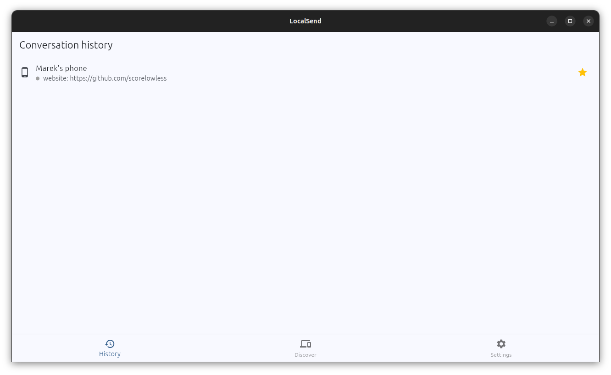
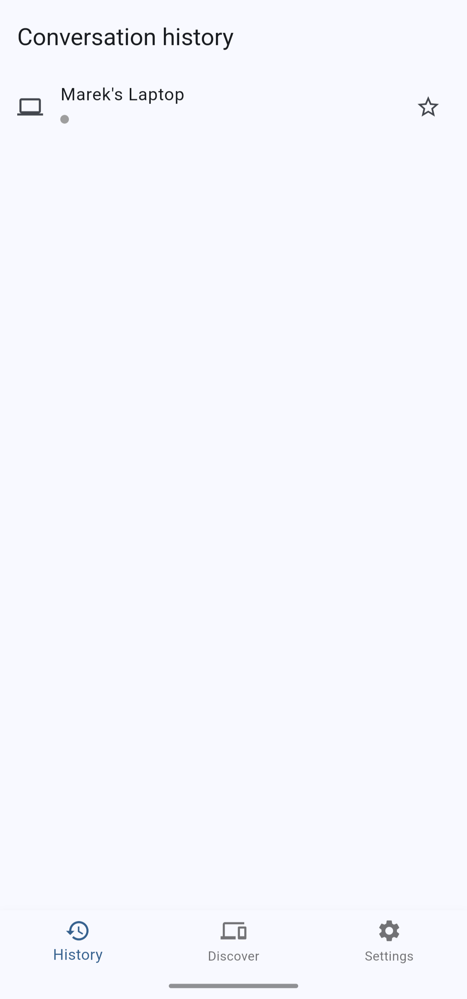

# LocalSend

Cross-platform Flutter application for file and message transfer between devices over a local area network (LAN)

The goal of the project is to enable easy transfer of messages between nearby devices without relying on online communicators or physical cables. While other solutions, such as Android's Quick Share offer similar service, they usually don't support Linux natively, while this project does.

The project was developed for a Flutter course on Warsaw University of Technology.

## Features
- Send and receive text messages over LAN
- Transfer files between devices
- Easy detection of nearby devices
- Android and Linux support
- Adjustable color theme
- Favorite devices and custom names
- English and Polish localization
- Online indicators

## Networking
The application detects nearby devices using UDP broadcast, while connection between two devices is handled by TCP. The app saves added devices between sessions and checks whether UDP broadcast detects them in order to determine if they are currently reachable. For each sent message, the app opens a TCP socket which connects to the TCP server of the recipient, sends the message with the metadata and closes the socket.

The networking layer was implemented and tested manually with real devices, including communication between different supported platforms.

## Screenshots


## Technologies
- Flutter
- Dart
- LAN networking
- Android
- Linux
- Kotlin

## Running
Pre-built binaries for Android & Linux are available on the [Releases page](https://github.com/scorelowless/local-send/releases).

- Android: Download the APK and install it on your device
- Linux (x86_64): Donwload and extract the archive, then run the application from the extracted directory

### Manual run
To run the code directly make sure you have [Flutter](https://docs.flutter.dev/get-started/install) installed and configured.

First, clone the repository
   ```bash
   git clone https://github.com/scorelowless/local-send.git
   cd local-send
   ```
Run the application on Linux:
```bash
flutter run -d linux
```

For running on Android see [the guide](https://docs.flutter.dev/platform-integration/android/setup)

## AI disclosure
ChatGPT and GitHub Copilot were used during development, primarily for code assistance and documentation. The application architecture and functionality was designed by me. The networking layer was manually designed, implemented and debugged by me, including message structure and networking scheme.
